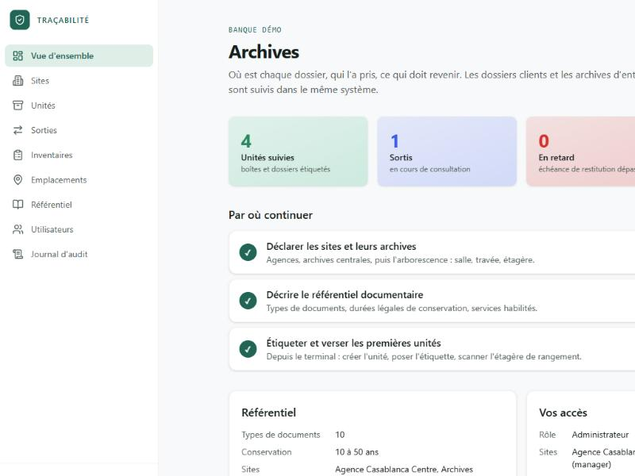
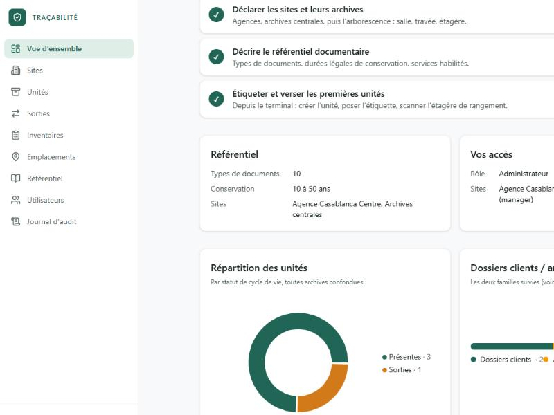
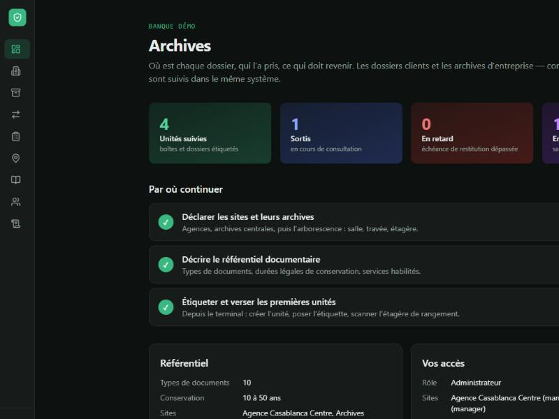
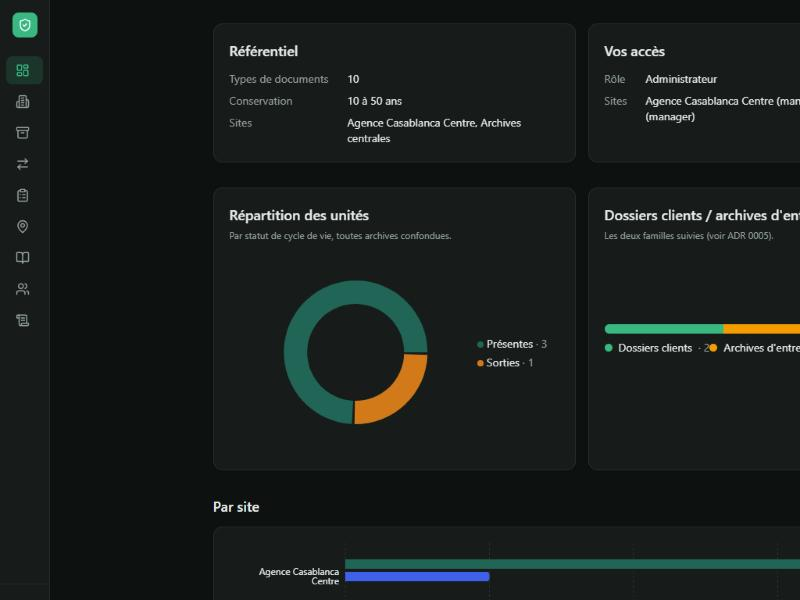
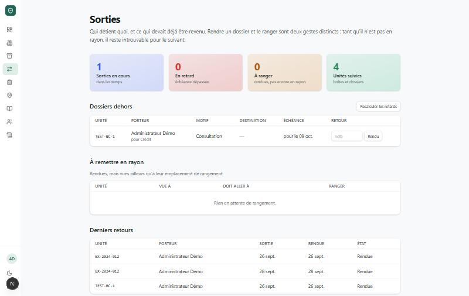
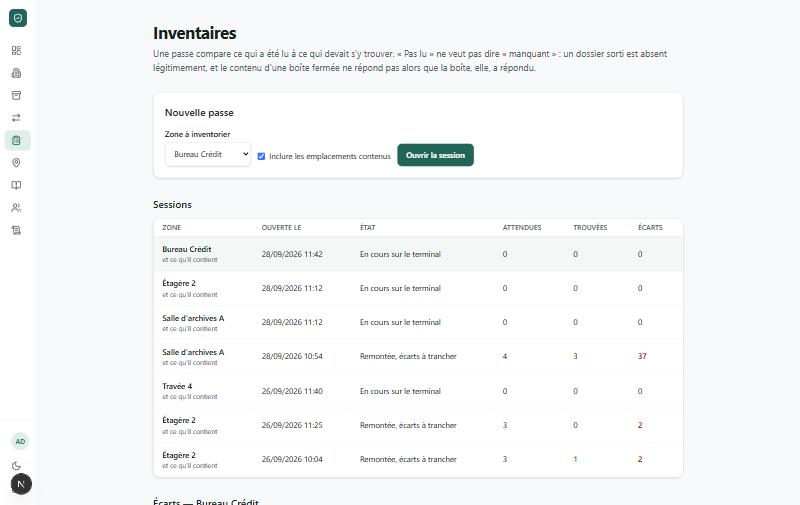
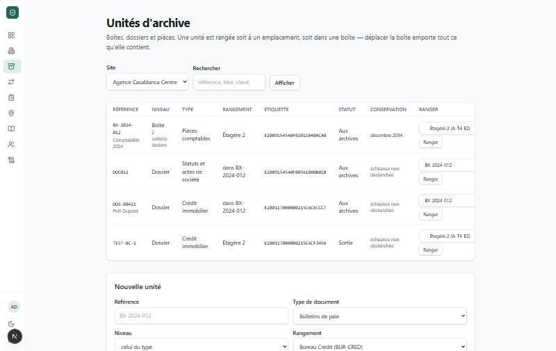
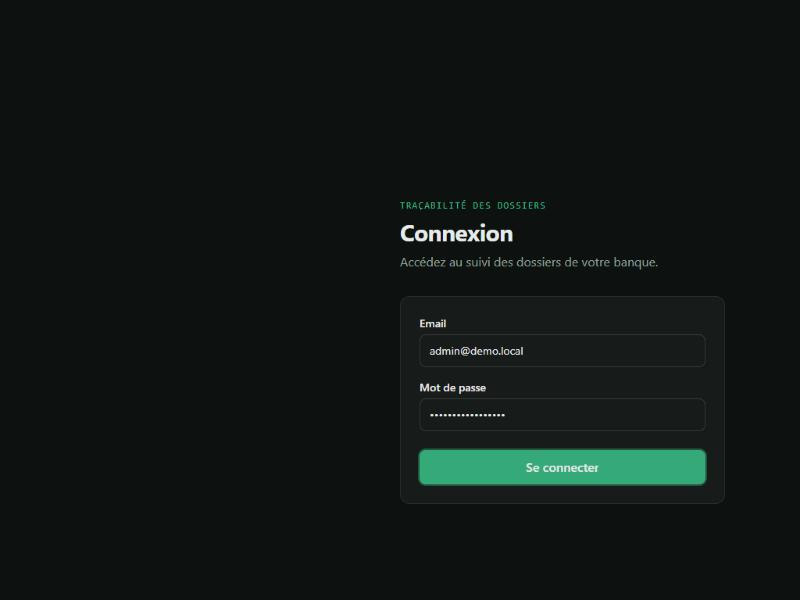
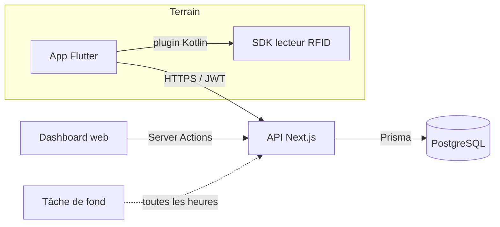

# Traçabilité RFID des dossiers bancaires

> **Dépôt vitrine.** Le code source de ce projet est privé (contexte client bancaire). Ce dépôt
> présente l'architecture, les choix techniques et des captures d'écran réelles de l'application,
> sans exposer de code propriétaire ni de données client.

## En une phrase

Un système qui répond à trois questions pour une banque : **où est un dossier papier, qui l'a pris,
et qu'est-ce qui manque à l'inventaire** — via des étiquettes RFID lues par un terminal durci, un
back-office web, et une file hors ligne qui tolère les coupures réseau des salles d'archives.

Projet solo, de la définition du besoin jusqu'à une image Docker de production, en passant par
l'intégration d'un lecteur RFID industriel dont le SDK officiel ne fonctionnait pas.

## Aperçu

| | |
|---|---|
|  |  |
|  |  |
|  |  |
|  |  |

*Données de démonstration — aucune information réelle de client ou de dossier bancaire.*

## Stack technique

| Couche | Choix | Pourquoi |
|---|---|---|
| Terrain | **Flutter** sur terminal Android durci (Chainway C72E) | Un seul code pour l'UI terrain ; plugin natif Kotlin pour le lecteur RFID |
| Back-end / dashboard | **Next.js 15** (App Router), **React 19**, Server Actions | Dashboard et API REST dans le même projet, pas de couche séparée à maintenir |
| Données | **PostgreSQL** + **Prisma** | Migrations versionnées, isolation multi-tenant stricte par organisation |
| Style | **Tailwind CSS v4** (CSS-first, tokens de thème), mode sombre | Composants qui changent de thème sans classe `dark:` répétée partout |
| Monorepo | **npm workspaces** + **Turbo** | Logique métier partagée (`packages/core`) entre le mobile, le web et les tests |
| Déploiement | **Docker** multi-étage, sortie Next `standalone` | Image de production construite et démarrée réellement, pas seulement écrite |

## Architecture

Convention centrale : **toute la logique métier vit dans `packages/core`**, jamais dans les routes
API ni dans les écrans. Le mobile, le web et les tests d'intégration appellent les mêmes fonctions
(`checkout`, `returnUnit`, `flagOverdueCheckouts`, `getOrganizationSummary`…), ce qui a évité une
classe entière de bugs de divergence entre les deux fronts.

## Principes qui structurent le modèle de données

1. **Étiquette ≠ dossier** — un dossier garde tout son historique quand son étiquette RFID est remplacée (puce abîmée, perdue…).
2. **Prévu ≠ observé** — l'emplacement *théorique* d'un dossier ne change que par une action validée (rangement, transfert) ; sa *dernière position vue* change à chaque lecture radio, sans validation.
3. **Sorti ≠ manquant** — un dossier régulièrement sorti n'est jamais compté manquant lors d'un inventaire : seuls les écarts réels remontent en alerte.
4. **L'étiquette est muette** — l'EPC radio est une référence opaque ; aucune donnée client n'est jamais écrite sur la puce.
5. **Une sortie a une échéance** — motif, porteur et date de retour attendue, calculée automatiquement selon le type de document (pas de saisie manuelle).

## Fonctionnalités

**Côté terrain (Flutter + RFID)**
- Scan en direct avec regroupement des lectures par étiquette, réglage de puissance, résolution vers la fiche du dossier.
- Création d'unité (boîte / dossier / pièce) avec imbrication — sortir une boîte emporte tout son contenu.
- Pose et remplacement d'étiquette, avec détection d'ambiguïté quand deux étiquettes ont un signal trop proche pour être départagées.
- Localisation au signal (jauge de proximité Froid → Brûlant).
- Sortie, retour et rangement — deux étapes distinctes, volontairement séparées (principe n°3).
- Inventaire par zone avec réconciliation automatique (trouvé / manquant / mal rangé / présumé dans sa boîte / étiquette inconnue).
- **File hors ligne** : les quatre gestes terrain fonctionnent sans réseau et se rejouent sans doublon au retour de la connexion.

**Côté dashboard web**
- Vue d'ensemble avec graphiques (répartition par statut, par famille de documents, comparaison par site).
- Gestion des sites, emplacements (arborescence salle → travée → étagère), référentiel documentaire (types, durées de conservation, destruction).
- Suivi des sorties et des retards (job planifié, recalcul manuel possible).
- Traitement des écarts d'inventaire, utilisateurs et rôles par site, journal d'audit.

## Le défi technique le plus intéressant : faire parler un lecteur RFID de 2018

Le terminal cible (Chainway C72E, Android 8.1) n'avait **aucun SDK officiel fonctionnel** : les
versions 2022, février 2025 et novembre 2025 échouaient toutes avec la même erreur bas niveau, y
compris la démonstration officielle du fabricant. Deux jours de diagnostic ont permis d'isoler la
cause : Chainway avait réécrit le cœur du SDK sans garder la compatibilité avec le firmware ancien
de cet appareil, et un jeu de bibliothèques natives incomplet produit exactement la même erreur
qu'une mauvaise version — ce qui faisait croire, au début, à un verrou matériel plutôt qu'à un SDK
dépareillé.

Solution : repérer la seule version de SDK (2019) compatible avec ce firmware précis, réunir les
douze bibliothèques natives nécessaires (une seule suffit à tout faire échouer), et écrire un plugin
Kotlin qui isole entièrement ce SDK derrière une interface Dart (`RfidReader`). Conséquence directe
de ce choix d'architecture : changer de lecteur plus tard ne touche que deux fichiers Kotlin — toute
la logique métier, les écrans et les tests restent inchangés.

## Hors ligne par construction, pas ajouté après coup

Les gestes terrain passent par une file d'attente locale avant tout appel réseau. Testé en conditions
réelles sur le terminal physique : coupure réseau en plein geste, file qui s'accumule, retour réseau,
rejeu automatique sans doublon — y compris le cas où le serveur refuse légitimement une action rejouée
(dossier déjà sorti entre-temps par quelqu'un d'autre).

## Qualité et mise en production

- **126 tests backend** (dont des tests d'intégration sur une vraie base PostgreSQL) et **44 tests
  mobiles**, couvrant l'isolation multi-tenant, l'authentification par rôles, et chaque règle métier
  du modèle de données.
- Image Docker de production **construite et démarrée réellement** à chaque mise à jour majeure —
  deux bugs de build réels ont été trouvés et corrigés en observant l'échec de `docker build`, pas en
  les devinant.
- Un journal technique tenu à jour à chaque étape (pièges rencontrés, décisions d'architecture),
  plutôt qu'une documentation reconstituée après coup.

## Où en est le projet

| Étape | Contenu |
|---|---|
| V1 (livrée) | Étiquetage, recherche, sorties/retours, inventaire, hors ligne, dashboard, mise en production |
| Prochaine étape | Transferts par bordereau entre sites |
| Vision V2 | Portiques RFID aux portes des archives, détection automatique, alertes temps réel |
| Vision V3 | Conservation et destruction réglementaire automatisées |

---

*Ce dépôt ne contient aucun code source du projet original, aucune donnée client, et aucun secret.
Les captures d'écran utilisent un jeu de données de démonstration généré pour l'occasion.*
